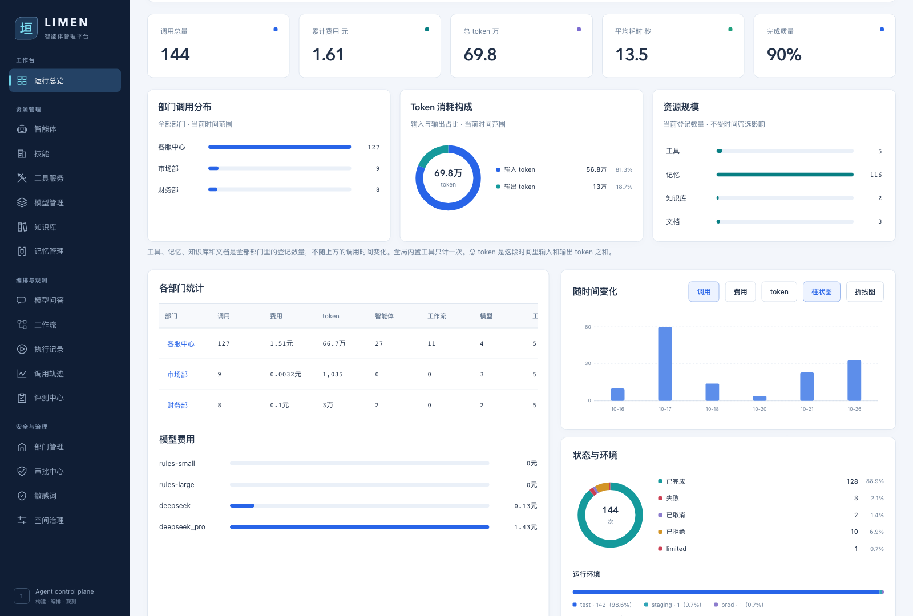
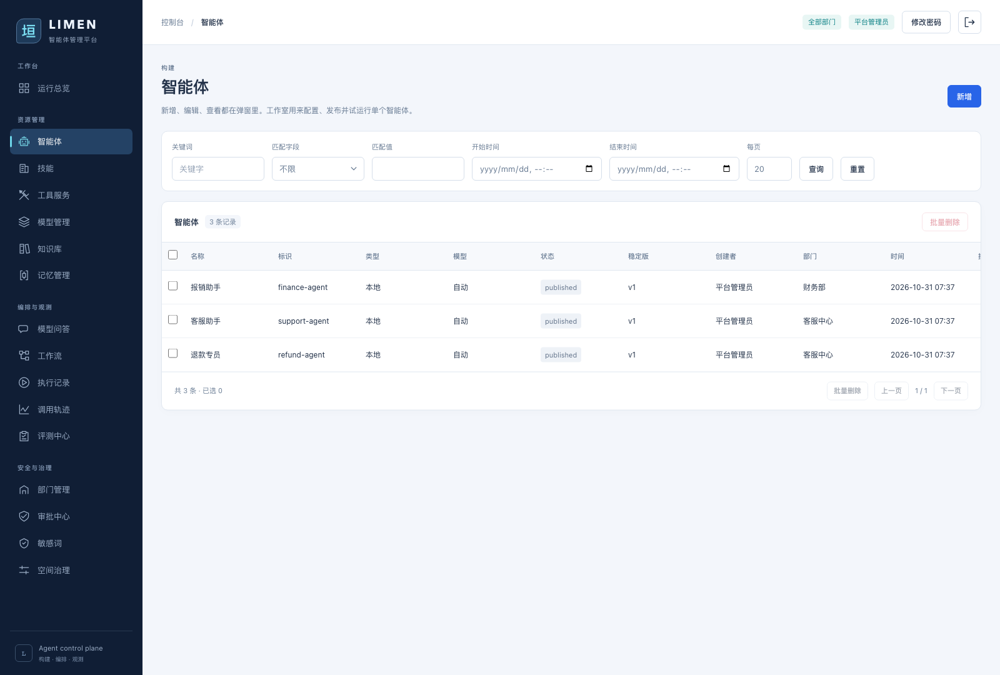
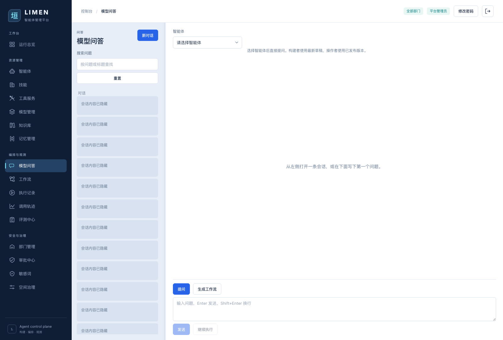
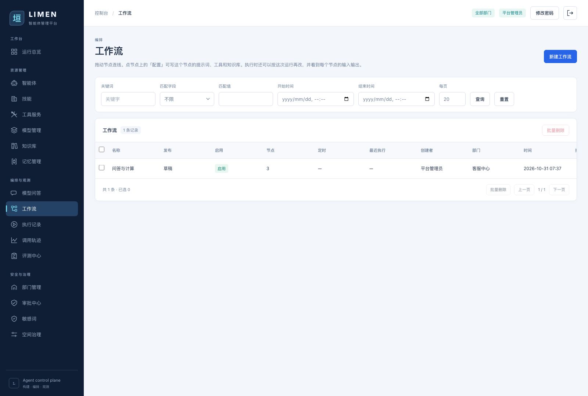
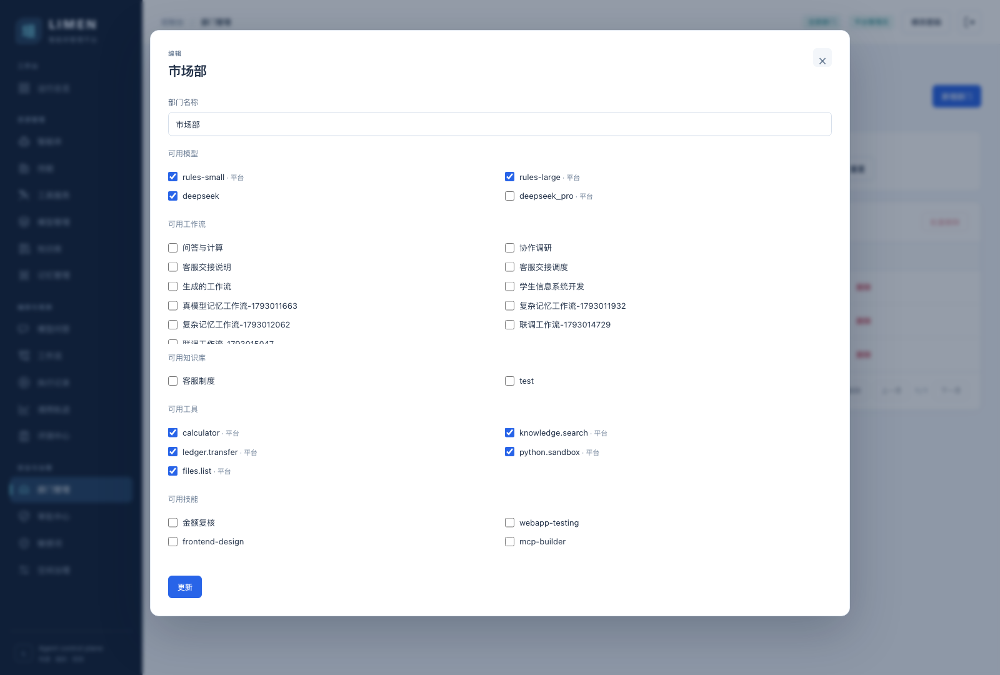

<div align="center">
  
  <h1>LIMEN · 垣</h1>
  <h3>Build agents. Orchestrate collaboration. Understand every run.</h3>
  <p>Manage models, tools, knowledge, and skills in your own environment.<br />From multi-turn conversations to autonomous workflows, with department grants and execution traces.</p>
  <p>
    <a href="#quick-start">Quick start</a> ·
    <a href="#preview">Screenshots</a> ·
    <a href="#docs">Documentation</a> ·
    <a href="https://github.com/yesterdayfuture/AgentManagement-Platform/issues">Issues</a> ·
    <a href="README.md">简体中文</a> · <strong>English</strong>
  </p>
  <p>
    
    
    
    
  </p>
</div>

---

LIMEN is a self-hosted agent management and runtime platform. Models handle understanding and decisions; a controlled runtime executes tools, knowledge retrieval, skill scripts, and business writes. Each run records steps, tokens, and cost. High-risk writes require approval before execution.

**Departments define resource access.** Models, workflows, knowledge bases, tools, and skills are granted by department. Platform administrators govern access; members work within their assigned permissions.

<a id="preview"></a>
## Screenshots



<p align="center"><sub>Captured from the running application · admin view · Chinese-language console</sub></p>

<table>
  <tr><th>Agent management</th><th>Model conversations</th></tr>
  <tr>
    <td></td>
    <td></td>
  </tr>
  <tr><th>Workflow orchestration</th><th>Department grants</th></tr>
  <tr>
    <td></td>
    <td></td>
  </tr>
</table>

[All screenshots and capture notes](docs/images/README.md)

## Core capabilities

| Capability | What you can do |
|---|---|
| **Agents and models** | Version prompts, manage model pools and tool permissions, and connect local agents or remote agents over synchronous HTTP, asynchronous HTTP, and A2A. |
| **Conversations** | Stream answers, render Markdown and formulas, inspect tool calls, and search sessions. Draft workflows from a question and publish after approval. |
| **Workflows** | Use fixed graphs or autonomous dispatch, version diffs and restore, concurrent edit checks, evaluation gates, failed-node retry, schedules, and token budgets. |
| **Evaluation and release** | Benchmark generation, math, task decomposition, and tool use with open BIG-bench and MMLU data; inspect per-case reports by agent or workflow version, set a pass-rate threshold, and gate release on evaluation. Platform admins can also evaluate unassigned agents. |
| **Knowledge and memory** | Ingest and retrieve documents, compress context, and inspect short-term memory, long-term memory, versioned user profiles, and provenance. |
| **Tools and skills** | Register built-in tools and MCP services; import SKILL.md packages and execute skill scripts inside Docker. |
| **Observability** | Filter by department; inspect usage trends, cost and token charts, live agent/workflow monitoring, run history, and traces. |
| **Access and governance** | Manage department grants, roles, secrets, approvals, sensitive-word checks, evaluations, and audit records. |

<a id="quick-start"></a>
## Quick start

Install Python (the project's test environment uses 3.13), Node.js, and npm. Docker is required to execute skill scripts; other features can be explored without skill execution. External model calls require a configured endpoint. The built-in `rules` model supports an offline demo.

### 1. Get the project

```bash
git clone https://github.com/yesterdayfuture/AgentManagement-Platform.git
cd AgentManagement-Platform
```

### 2. Start the backend

Open a terminal at the repository root:

```bash
cd backend
python3 -m venv .venv
.venv/bin/pip install -r requirements.txt
.venv/bin/python -m uvicorn app.main:app --host 127.0.0.1 --port 8000
```

### 3. Start the console

Open another terminal at the repository root:

```bash
cd frontend
npm install
npm run dev
```

Visit [http://127.0.0.1:5173](http://127.0.0.1:5173). Vite proxies API requests to `:8000`. These commands target macOS / Linux; on Windows, use `.venv\Scripts\python.exe` and `.venv\Scripts\pip.exe`.

Alternatively, run `npm --prefix frontend run build` and start only the backend. It serves the built console at [http://127.0.0.1:8000](http://127.0.0.1:8000). Rebuild after changing Vue sources; restart the backend after changing Python.

### Demo accounts

The first startup with an empty database creates these accounts. Starting an existing database does not reset passwords.

| Username | Password | Access |
|---|---|---|
| `admin` | `admin123` | Platform administrator |
| `builder` | `builder123` | Customer Support builder |
| `operator` | `operator123` | Customer Support operator |
| `viewer` | `viewer123` | Customer Support viewer |
| `finance` | `finance123` | Finance builder |

The default database is `backend/data/app.db`; override it with `DATABASE_URL`. Demo credentials are for local exploration. Change default passwords and configure service secrets before exposing the deployment.

## Start with one call

1. Open **Model conversations** (模型问答), select “客服助手,” and ask “请计算 128 + 256”.
2. Expand the tool call to inspect arguments and results, then open its trace.
3. Configure models, tools, and skills under **Agents** and try a studio run.
4. Combine agents in **Workflows**, or draft a workflow from a conversation for approval.
5. Return to **Overview** to inspect department usage, cost, resources, and runtime status.

<a id="docs"></a>
## Documentation

| Guide | Topics |
|---|---|
| [Console and runtime guide](docs/console-guide.en.md) | Full page reference, roles, APIs, streaming, and billing conventions |
| [Autonomous workflows](docs/autonomous-agent.md) | Planning, member responsibilities, dispatch, and execution |
| [Draft workflows from chat](docs/ask-workflow.md) | Drafting prompts, model input, and approval flow |
| [P0 loops and DeepSeek evaluation](docs/p0-closures-evaluation.md) | Versions, release gates, retries, and 1,047 open benchmark cases (Chinese) |
| [MMLU general capability evaluation](docs/mmlu-evaluation.md) | Multidisciplinary, complex math, decomposition, tool use, and constrained generation in the existing space (Chinese) |
| [Context and memory](docs/context-memory.md) | Long-context compression, three-tier memory, and provenance |
| [Skills and containers](docs/skills.md) | Skill packages, grants, and isolated execution |
| [Built-in tool development](docs/builtin-tools.md) | Register a tool and connect it to the runtime |
| [Remote asynchronous agents](docs/remote-async-agent.md) | Python + FastAPI integration example |
| [Sensitive-word monitoring](docs/sensitive-words.md) | Input, output, and streaming checks |

The console/runtime guide is available in English; topic-specific guides are currently in Chinese.

## Project structure

```text
frontend/                 Vue 3 + Vite console
backend/app/api/routers/   FastAPI domain endpoints
backend/app/services/      Agents, workflows, models, tools, and memory
backend/app/models.py      SQLAlchemy data models
backend/tests/             API and runtime regression tests
docs/                      Guides and screenshots
scripts/                   Remote agent example
```

## Development checks

Run from the repository root:

```bash
backend/.venv/bin/python -m pytest backend/tests -q
npm --prefix frontend run build
```

Backend tests use temporary SQLite databases, not the development database. Test mode does not start the skill container. Some integration tests require permission to bind local ports.

---

<p align="center"><a href="README.md">阅读中文版</a> · <a href="#quick-start">Get started with LIMEN</a></p>
