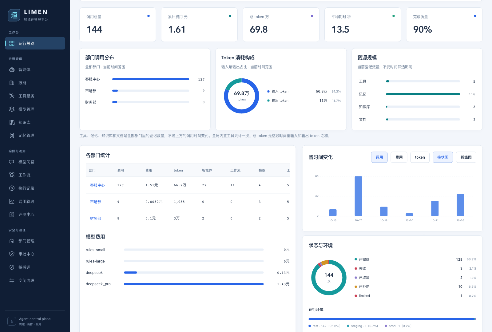
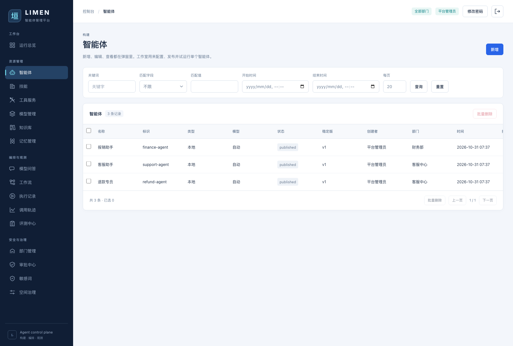
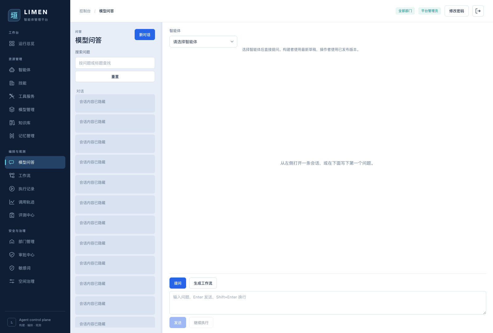
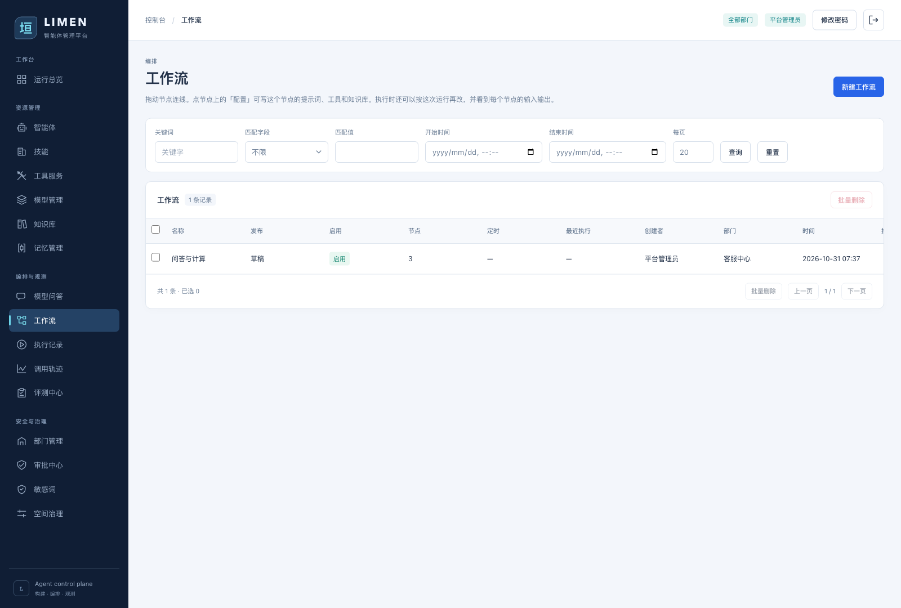
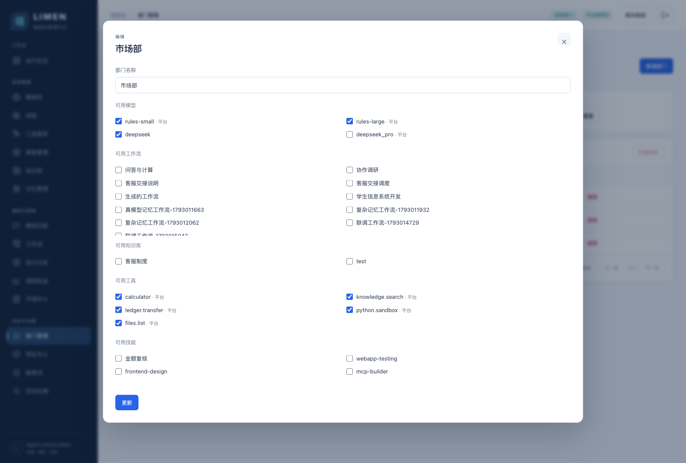

<div align="center">
  
  <h1>垣 · LIMEN</h1>
  <h3>构建智能体，编排协作，让每一次运行清晰可控。</h3>
  <p>在自己的环境中统一管理模型、工具、知识与技能。<br />从多轮问答到自主工作流，从部门授权到调用追踪。</p>
  <p>
    <a href="#quick-start">快速开始</a> ·
    <a href="#preview">界面预览</a> ·
    <a href="#docs">使用文档</a> ·
    <a href="https://github.com/yesterdayfuture/AgentManagement-Platform/issues">问题反馈</a> ·
    <strong>简体中文</strong> · <a href="README.en.md">English</a>
  </p>
  <p>
    
    
    
    
  </p>
</div>

---

LIMEN 是一套可自部署的智能体管理与运行平台。模型负责理解和决策，受控运行时负责工具执行、知识检索、技能脚本和业务写入。每次运行记录步骤、token 与费用；高风险写入先审批再执行。

**部门是资源授权边界。** 模型、工作流、知识库、工具和技能按部门开放，平台管理员统一治理，部门成员在各自权限内使用。

<a id="preview"></a>
## 界面预览



<p align="center"><sub>当前运行界面 · admin 视角 · 中文控制台</sub></p>

<table>
  <tr><th>智能体管理</th><th>模型问答</th></tr>
  <tr>
    <td></td>
    <td></td>
  </tr>
  <tr><th>工作流编排</th><th>部门与资源授权</th></tr>
  <tr>
    <td></td>
    <td></td>
  </tr>
</table>

[查看完整截图与拍摄说明](docs/images/README.md)

## 核心能力

| 能力 | 可以做什么 |
|---|---|
| **智能体与模型** | 管理提示词版本、模型池和工具权限；接入本地智能体，以及 HTTP 同步、异步和 A2A 远程智能体。 |
| **多轮问答** | 流式回答、Markdown 与公式渲染、工具调用展开、会话搜索；从问题起草工作流，审批后发布。 |
| **工作流协作** | 固定连线与自主调度、版本差异与恢复、并发编辑检测、评测后发布、失败节点重试、定时执行和 token 预算。 |
| **评测与发布** | 使用 BIG-bench、MMLU 等开源数据集评测生成、计算、任务拆解和工具调用；按智能体/工作流版本查看逐题报告、设置通过比例，并以评测结果控制上线。平台管理员也可评测未分配空间的智能体。 |
| **知识与记忆** | 文档入库与检索、上下文压缩、短期/长期记忆、用户画像版本与来源追溯。 |
| **工具与技能** | 内置工具、MCP 服务、SKILL.md 压缩包导入；技能脚本在 Docker 容器中运行。 |
| **运行观测** | 部门筛选、调用趋势、费用与 token 图表、智能体/工作流运行监控、执行记录和轨迹。 |
| **权限与治理** | 部门资源授权、角色权限、密钥管理、审批、敏感词监测、评测和审计。 |

<a id="quick-start"></a>
## 快速开始

准备 Python（项目测试环境使用 3.13）、Node.js 与 npm。执行技能脚本还需要 Docker；不使用技能脚本时可先体验其他功能。实际调用外部模型需要配置模型接入点；内置 `rules` 模型可用于离线演示。

### 1. 获取项目

```bash
git clone https://github.com/yesterdayfuture/AgentManagement-Platform.git
cd AgentManagement-Platform
```

### 2. 启动后端

在项目根目录打开一个终端：

```bash
cd backend
python3 -m venv .venv
.venv/bin/pip install -r requirements.txt
.venv/bin/python -m uvicorn app.main:app --host 127.0.0.1 --port 8000
```

### 3. 启动控制台

在项目根目录另开一个终端：

```bash
cd frontend
npm install
npm run dev
```

打开 [http://127.0.0.1:5173](http://127.0.0.1:5173)。Vite 将接口请求代理到 `:8000`。以上命令适用于 macOS / Linux；Windows 使用 `.venv\Scripts\python.exe` 和 `.venv\Scripts\pip.exe`。

也可运行 `npm --prefix frontend run build`，再只启动后端；构建产物会由后端托管，访问 [http://127.0.0.1:8000](http://127.0.0.1:8000)。修改 Vue 源码后需重新构建，修改 Python 后需重启后端。

### 演示账号

首次启动空数据库时创建以下账号；已有数据库启动不会重置密码。

| 用户名 | 密码 | 权限 |
|---|---|---|
| `admin` | `admin123` | 平台管理员 |
| `builder` | `builder123` | 客服中心构建者 |
| `operator` | `operator123` | 客服中心操作者 |
| `viewer` | `viewer123` | 客服中心只读用户 |
| `finance` | `finance123` | 财务部构建者 |

默认数据库为 `backend/data/app.db`，可通过 `DATABASE_URL` 指定。演示账号用于本地体验，对外部署前请修改默认密码并配置服务密钥。

## 从一次调用开始

1. 登录后打开 **模型问答**，选择「客服助手」，尝试“请计算 128 + 256”。
2. 展开工具调用，查看入参和结果；从回答打开调用轨迹。
3. 在 **智能体** 中调整模型、工具和技能，在工作室试运行。
4. 在 **工作流** 中组合智能体，或通过问答生成待审批草案。
5. 回到 **运行总览**，按部门查看调用、费用、资源与运行状态。

<a id="docs"></a>
## 文档导航

| 文档 | 内容 |
|---|---|
| [控制台与运行指南](docs/console-guide.zh.md) | 完整页面说明、角色规则、接口索引、流式执行与费用口径 |
| [自主调度工作流](docs/autonomous-agent.md) | 规划、成员职责、调度与执行 |
| [问答生成工作流](docs/ask-workflow.md) | 草案提示词、模型输入与审批流程 |
| [P0 闭环与 DeepSeek 评测](docs/p0-closures-evaluation.md) | 版本、发布门禁、失败重试及 1,047 条开源基准用例 |
| [MMLU 综合能力评测](docs/mmlu-evaluation.md) | 现有空间中的多学科、复杂计算、拆解、工具调用与文本生成评测 |
| [知识、上下文与记忆](docs/context-memory.md) | 长上下文压缩、三层记忆及溯源 |
| [技能与容器](docs/skills.md) | 技能包格式、授权及隔离执行 |
| [内置工具开发](docs/builtin-tools.md) | 注册工具并接入运行时 |
| [远程异步智能体](docs/remote-async-agent.md) | Python + FastAPI 接入示例 |
| [敏感词监测](docs/sensitive-words.md) | 输入、输出与流式内容检测 |

## 技术结构

```text
frontend/                 Vue 3 + Vite 控制台
backend/app/api/routers/   FastAPI 领域接口
backend/app/services/      智能体、工作流、模型、工具与记忆服务
backend/app/models.py      SQLAlchemy 数据模型
backend/tests/             API 与运行时回归测试
docs/                      使用指南与界面截图
scripts/                   远程智能体示例
```

## 开发验证

在项目根目录运行：

```bash
backend/.venv/bin/python -m pytest backend/tests -q
npm --prefix frontend run build
```

后端测试使用临时 SQLite 数据库，不读写开发库；测试模式不启动技能容器。部分集成测试需要本地端口权限。

---

<p align="center"><a href="README.en.md">Read in English</a> · <a href="#quick-start">开始使用 LIMEN</a></p>
