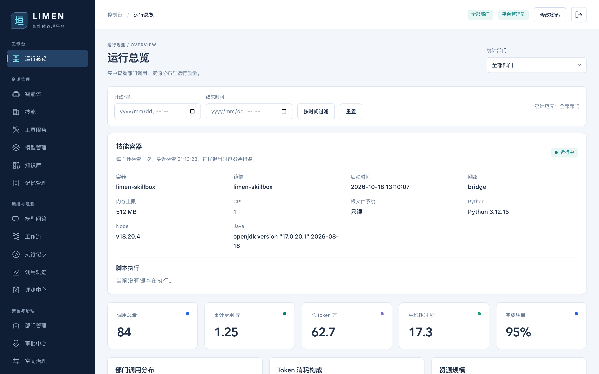
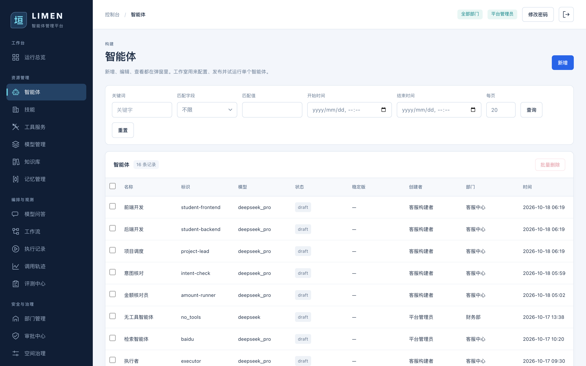
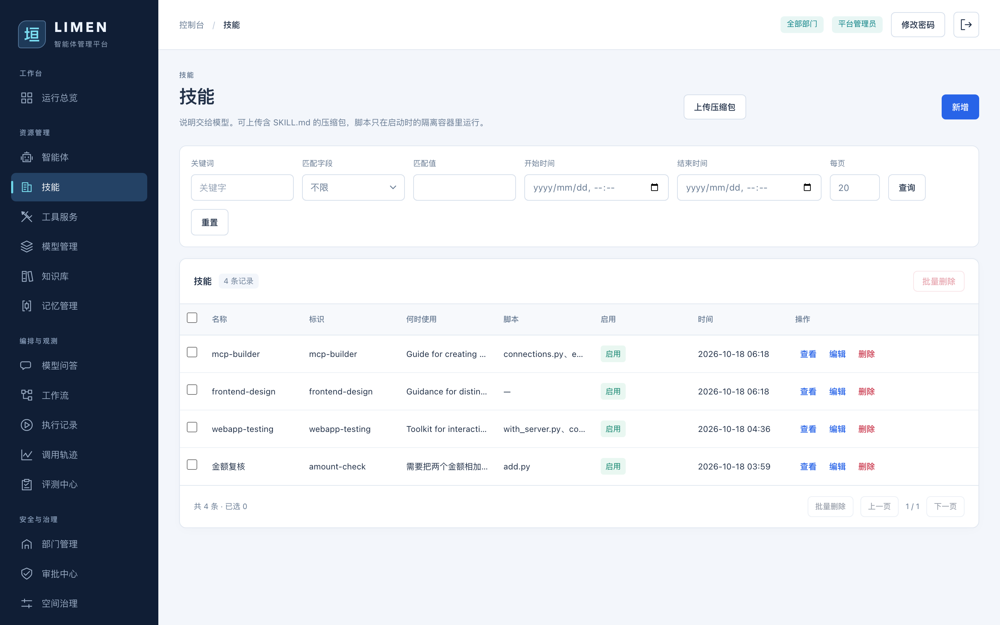
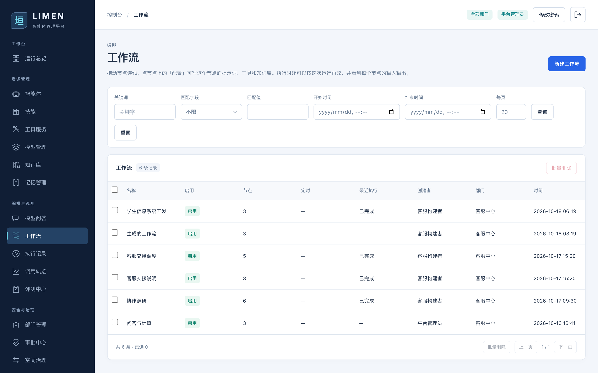
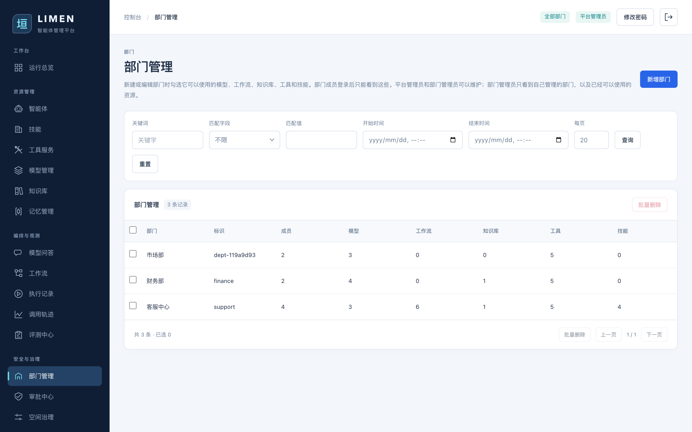
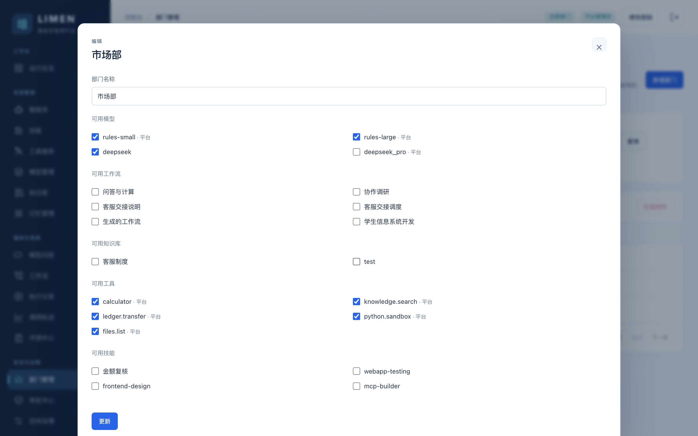
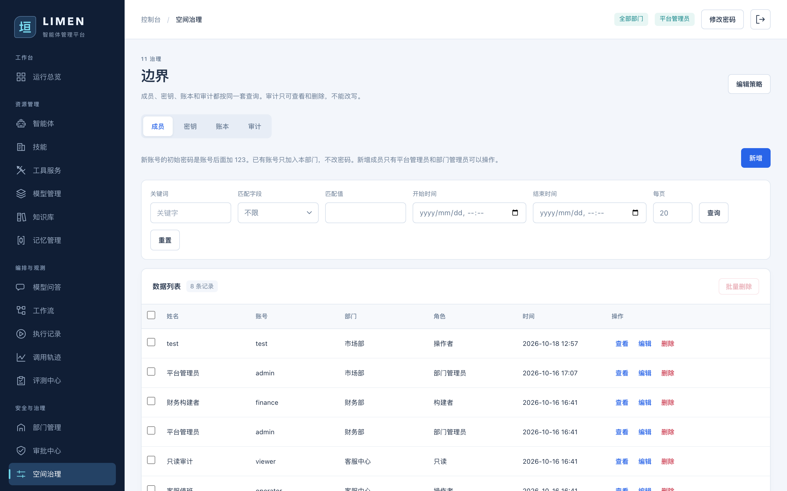

# 垣 · LIMEN

[中文](README.md) · [English](README.en.md)

垣是一套留在本机的智能体运行平面。模型负责理解与决策；工具、检索、账本和技能脚本在受控运行时里执行。每一次调用留下轨迹、步骤和费用。高风险写入先挂起，审批通过后才落账。

部门是隔离边界。模型、工作流、知识库、工具和技能都要授权之后，这个部门的成员才看得到、用得上。没有权限的入口不会出现在控制台上。



技能容器 `limen-skillbox` 随接口进程拉起，进程退出时销毁。脚本只在这只容器里执行。总览每秒读取容器状态，以及正在执行和刚结束的脚本作业。

## 技术组成

| 部分 | 位置 | 说明 |
|---|---|---|
| 控制台 | `frontend/` | Vue 3 + Vite。构建产物在 `frontend/dist`，由后端同一进程托管。 |
| 接口 | `backend/app/` | FastAPI。入口是 `backend/app/main.py` 的 `app`。 |
| 数据 | SQLite + SQLAlchemy | 默认库文件 `backend/data/app.db`。可用环境变量 `DATABASE_URL` 换库。 |
| 测试 | `backend/tests/test_platform.py` | 使用内存库，不读写开发库。 |

依赖见 `backend/requirements.txt` 和 `frontend/package.json`。

## 目录

```
backend/app/main.py                         进程入口，调用 create_app
backend/app/core.py                         建库、补列、种子数据、托管前端
backend/app/api/                            HTTP 接口包，按领域拆在 routers/
backend/app/api/routers/conversations.py    模型问答会话
backend/app/models.py                       表结构
backend/app/seed.py                         空库演示数据，以及旧库补登记
backend/app/services/runtime/               智能体循环、工作流和评测
backend/app/services/gateway.py             意图分类和工具闸门
backend/app/services/builtins.py            内置工具的参数说明
frontend/src/views/Ask.vue                  模型问答页
frontend/src/views/TraceDetail.vue          单次调用轨迹
frontend/src/App.vue                        左侧导航
docs/builtin-tools.md                       如何新增一个内置工具
docs/skills.md                              技能说明、压缩包、授权和容器执行
docs/ask-workflow.md                        问答生成工作流：提示词与完整模型输入
docs/autonomous-agent.md                    自主调度工作流
docs/remote-async-agent.md                  用 Python + FastAPI 开发远程异步智能体
docs/images/                                控制台截图
README.md / README.en.md                    中英文主文档（页首互相切换）
```

## 本地启动

日常开发常用两进程：接口 `:8000`，控制台 Vite `:5173`（热更新，不必每次 build）。

```bash
# 终端 1：接口
cd backend
python3 -m venv .venv
.venv/bin/pip install -r requirements.txt
.venv/bin/python -m uvicorn app.main:app --host 127.0.0.1 --port 8000

# 终端 2：控制台
cd frontend
npm install
npm run dev
```

浏览器打开 `http://127.0.0.1:5173`。改了 Python 后需要重启 uvicorn。

也可以先 `npm run build`，再只起后端（例如 `:8026`）；后端发现 `frontend/dist` 后由同一进程托管页面。此时改 Vue 源码后需要重新 build。

`DATABASE_URL` 不设置时，库文件是 `backend/data/app.db`。用户表为空时，`seed()` 写入演示数据。之后每次启动都会执行 `ensure_builtin_tools()`，给已有库补上缺失的全局内置工具。演示账号只在空库种子里出现；已有库启动不会重置密码。

## 演示账号

空库第一次启动后可以使用：

| 用户名 | 密码 | 角色 |
|---|---|---|
| admin | admin123 | 平台管理员 |
| builder | builder123 | 客服中心构建者 |
| operator | operator123 | 客服中心操作者 |
| viewer | viewer123 | 客服中心只读 |
| finance | finance123 | 财务部构建者 |

演示空间有「客服中心」「财务部」「市场部」。空间内角色从低到高是 viewer、operator、builder、admin。平台管理员是用户标志，不受单个空间角色限制。请求带登录令牌和 `X-Space-Id`。

## 控制台

左侧导航是控制面。资源、编排和治理分成三组：

1. 运行总览：智能体与工作流实时监控卡片（每 3 秒刷新，可折叠；点卡片进配置/执行）、部门调用、资源，以及按密钥汇总的模型调用和 MCP 调用。见下文
2. 智能体：版本、系统提示、开放的工具、发布和运行。工作室试运行可勾选**流式输出**（默认关闭，仅本地智能体）。平台管理员新建时可以不分配部门，这种智能体的部门显示为「平台」
3. 工具服务：内置工具登记，以及 MCP 连接。访问 token 写入当前部门的密钥库
4. 模型管理：按任务类型和价格从池子里选；`provider=rules` 时不访问外网。API Key 按**模型所属部门**写入密钥库；编辑时留空不更换，填入新 Key 会换绑并清理无引用旧密钥
5. 知识库：文档入库和检索
6. 记忆管理
7. 技能：说明交给模型，脚本在隔离容器里执行。可上传含 SKILL.md 的压缩包。查看时显示存储位置。原理见 [docs/skills.md](docs/skills.md)
8. 模型问答：多轮对话，可切到「生成工作流」起草草案。回答展示版本、工具次数、token、花费和停止原因。见下文
9. 工作流：区分草稿与已发布；操作者只能执行已发布图。执行/在线测试可勾选**流式输出**（默认关闭；定时执行不可用）。执行/定时前确认模型与费用参考，定时可设 token 上限。节点和执行时都可以改可用技能
10. 执行记录：写出版本、工具次数、token、花费和停止原因，并跳回工作流
11. 调用轨迹：一次运行的步骤和费用；可对质量投票。查看弹层和单页都可以返回
12. 评测中心
13. 审批中心：高风险写入，以及问答起草的工作流草案。待审草案可改名、改节点；通过后才入库并发布。可跳回原问答或工作流
14. 空间治理：成员、密钥、账本、审计，以及上下文屏蔽、脱敏、保留天数和部门 token 额度。新增成员只有平台管理员和部门管理员可以操作
15. 部门管理：只有平台管理员可以新增和删除部门。部门管理员只能查看和编辑自己管理的部门，并勾选可用模型、工作流、知识库、工具和技能

## 模型问答

页面在 `/ask`。左侧是会话列表，可以搜索和新建。普通成员和部门管理员看到的是当前部门里的会话；平台管理员看到各部门的会话。鼠标停在一条会话上时，右侧出现「···」，可重命名、置顶、复制分享链接、多选删除或删除。置顶的会话单独成组。中间分隔条可拖动，宽度记在浏览器本地。右侧选择智能体后提问。底部可在「提问」和「生成工作流」之间切换。点击发送后，问题立刻出现在上方对话里，输入框清空。回答按模型吐出的片段流式显示；模型路径没有逐段输出时，完成稿仍会拆成短片段推上来。Enter 发送，Shift+Enter 换行。第一条问题会写成会话标题，最多 24 个字。回答按 Markdown 显示，工具调用可以展开入参和输出，并能复制或打开对应轨迹。助手消息下方会写出版本、工具次数、token、花费和停止原因（与总览同一套数量/金额格式：token 满万显示「万」，花费用「元」）。回答失败时，问题留在对话里，只去掉尚未完成的回答，不会把问题填回输入框。

后续问题会带上这条会话里已有的问答。连得上的模型一次最多循环 20 轮。同一段对话里，同一个工具用相同参数成功执行过后不再调用；模型若只重复这次调用，循环会停下来并要一次最终回答。参数不同的调用仍会执行，参数错误或暂时失败的调用还可以重试。若第 20 轮仍是新的工具调用，回答会停在上限，「继续执行」会带上已保存的对话和工具结果接着跑，已经成功过的相同参数也不会再执行。公式类回答用 KaTeX 渲染。

权限与其他页面一致：

| 动作 | 谁可以 |
|---|---|
| 查看、搜索 | 只读及以上。普通成员只看自己在当前部门的会话；部门管理员看本部门全部会话；平台管理员看各部门的会话 |
| 新建、改标题、换智能体、删除 | 操作者及以上，且只能改自己的会话。部门管理员可以改、删本部门会话；平台管理员可以改、删各部门的会话 |
| 发送、继续执行、生成工作流 | 操作者及以上，且只能在自己的会话里提问 |

构建者、部门管理员和平台管理员使用智能体的最新草稿；操作者使用已发布版本。部门成员只能选择本部门的智能体。平台管理员可以选用任意部门的智能体，这次问答记在该智能体所属部门，并使用那个部门的模型授权和额度。未分配部门的智能体只出现在平台管理员的下拉里，标成「平台」；问答记在管理员当前所在部门，额度按这个部门计算，模型则可以使用任意已启用的接入点，不看部门授权。部门成员不能对这种智能体发起会话。

### 用问答生成工作流

切换到「生成工作流」后，输入任务并发送，会调用 `POST /api/chats/{id}/workflow`：只起草待审批草案，**不会**立刻写入工作流列表。对话里可以「改草案」（弹窗改名、改节点 JSON），或跳到「审批」核对；通过后才以**已发布**状态进入工作流管理。审批单、问答会话和工作流之间会带上原任务与编号，可互相跳转。

**选不同智能体时，起草用的提示词基本一致。** 不会把当前智能体自己的 system prompt 整段塞进这次请求。差别只有：

| 项 | 行为 |
|---|---|
| 用哪颗模型 | 优先当前智能体绑定的模型；没有则用本部门已授权里更贵的非 `rules` 模型 |
| 审批 / 轨迹记在谁名下 | `agent_id` 为当前选中的智能体 |
| 可用智能体名单 | 取该智能体所在部门的全部智能体；职责只取各版本 system prompt 的**第一行**（最多 80 字） |

真正发给模型的只有两条消息：`system`（固定起草说明 + 名单）+ `user`（任务原文）。**没有**工具、**没有**会话历史。实现见 `conversations.propose_workflow`。

完整输入示例（部门含编排者、规划者、写作者、审稿人等；任务与界面常见退款交接一致）：

```json
[
  {
    "role": "system",
    "content": "根据任务描述设计一条工作流，只输出一个 JSON 对象，不要解释。\nkind 用 agents 表示按连线依次执行，用 autonomous 表示第一个节点调度后面的成员。\nnodes 里只写 agent_id，必须来自下面的编号。至少两个节点。edges 用 src、dst，节点编号按出现顺序写成 n1、n2。\n可用智能体：\n- 4 编排者：编排者已接单。未点名的子任务由编排者自己执行。句子里出现规划者、研究员、写作者、审稿人或执行者时，分发给对应角色。\n- 5 规划者：规划者已列出步骤。顺序是检索、起草、核对，再交给执行者处理可计算的部分。\n- 7 写作者：写作者已完成草稿。写作者只负责成稿，不负责检索和终审。\n- 8 审稿人：审稿人已完成核对。审稿人检查是否有依据、是否跑题，不直接改业务数据。\n（同部门其余智能体同样一行）"
  },
  {
    "role": "user",
    "content": "请为客服中心「要把一笔退款交给财务部处理」起草一条工作流。节点依次用规划者、写作者、审稿人，并在流程里计算 80 + 48。"
  }
]
```

模型应只返回类似：

```json
{
  "name": "生成的工作流",
  "kind": "agents",
  "nodes": [{"agent_id": 5}, {"agent_id": 7}, {"agent_id": 8}],
  "edges": [{"src": "n1", "dst": "n2"}, {"src": "n2", "dst": "n3"}]
}
```

后端解析后写入审批草案。节点上真正执行时的提示词，是审批通过后在工作流里另配的，**不是**这次起草请求里写的。更多说明见 [docs/ask-workflow.md](docs/ask-workflow.md)。

接口在 `backend/app/api/routers/conversations.py`：

| 方法 | 路径 | 作用 |
|---|---|---|
| GET | `/api/chats?q=` | 按标题或用户问题查找 |
| POST | `/api/chats` | 新建，正文含 `agent_id` |
| GET | `/api/chats/{id}` | 会话和消息（助手消息含 token、花费、版本、审批与草案摘要） |
| PATCH | `/api/chats/{id}` | 改 `title`、`agent_id` 或 `pinned` |
| DELETE | `/api/chats/{id}` | 删除会话和消息 |
| POST | `/api/chats/{id}/messages` | 发送。`continue_run=true` 时从上一轮上限继续；`stream=true` 时以 SSE 返回 `delta`、`tool`、`reset`、`error` 和 `done` |
| POST | `/api/chats/{id}/workflow` | 按任务起草工作流草案并创建待审审批；不写入工作流列表 |

列表支持分页、关键字、精确字段和时间范围。不传 `page` 时接口返回数组；传入 `page` 时返回 `{items, total, page, page_size}`。

## 智能体

智能体按版本保存系统提示、模型、工具和技能。构建者、部门管理员和平台管理员运行最新草稿；操作者运行已发布版本。勾选技能时，说明会写入提示词末尾的「可用技能」一段，模型按「何时使用」决定要不要调用。

### 工作室试运行与流式输出

页面在 `/agents/{id}`。左侧改配置与版本，右侧试运行。本地智能体（`kind=local`）可勾选「流式输出」，**默认关闭**：

| `stream` | 行为 |
|---|---|
| `false`（默认） | `POST /api/agents/{id}/run` 同步返回完整结果 JSON |
| `true` | 同一路径以 SSE 推送：`delta`（正文片段）、`tool`（正在调工具）、`reset`（工具轮后清空已推正文）、`error`、`done`（含完整 `result`） |

勾选后边生成边显示；模型路径未逐段吐字时，完成后端仍会把成稿拆成短片段推上。远程智能体不支持流式，勾选无效且接口会拒绝 `stream=true`。实现上由 `gateway._CHAT_EMIT` 在模型调用时打开流式补全；前端须更新响应式数组里的消息对象，才会边收边刷界面。

也支持 **远程智能体**（`kind=remote`）：在本机登记身份与协议，执行时转发到外部服务，轨迹仍写在本地。协议：

| 协议 | 说明 |
|---|---|
| `http_sync` | `POST` 远端，同步拿 `output` |
| `http_async` | `POST` 远端并附带 `callback_url` / `callback_token`；平台先返回 `waiting`，远端再回调 `POST /api/agents/{id}/remote-complete` |
| `a2a` | JSON-RPC `SendMessage`；地址可以是 RPC URL，或根地址（读取 `/.well-known/agent-card.json`） |

远程智能体不挂本机工具、技能、MCP。**简介**写给本平台用户看（职责、远端工具与适用场景），新建时默认为空；会出现在总览与选型处。可选填 **健康探测**（GET/POST）；未填时总览标「无法实时监测」，只显示基本信息。异步回调地址由环境变量 `LIMEN_PUBLIC_BASE`（默认 `http://127.0.0.1:8000`）拼出。

演示脚本 `scripts/remote_agent_demo.py` 会从本库读取 `deepseek_pro`（或名称含 deepseek 的接入点）配置，拉起同步/异步 HTTP 与 A2A 三种远端，并在平台登记对应简介后试跑。长期驻留用 `--serve`。用 Python + FastAPI 从零接远程异步协议，见 [docs/remote-async-agent.md](docs/remote-async-agent.md)。



相关接口：

| 方法 | 路径 | 作用 |
|---|---|---|
| POST | `/api/agents/{id}/run` | 试运行。正文含 `message`、`environment`、`history`、`resume_trace_id`；`stream` 默认 `false`，本地智能体为 `true` 时返回 SSE |
| POST | `/api/agents/{id}/remote-complete` | 异步远程智能体回调完成 |

## 技能

页面在 `/skills`。说明交给模型阅读；脚本文件存在 `backend/data/skills/{编号}/`，只在容器 `limen-skillbox` 里执行。容器随进程退出删除。查看和编辑时，对话框显示「存储位置」，对应 `GET /api/skills/{id}` 的 `storage_path`。新建时目录尚未产生。



一个部门能使用哪些技能，在部门管理里勾选，记在授权表 `department_grants` 的 `kind=skill`。新建和导入默认只授给当前部门。别的部门在授权之前，技能列表、智能体勾选和工作流里都不会出现它。本部门创建的技能可以修改和删除；授权过来的技能可以查看和使用，页面上没有编辑和删除。

智能体、工作流节点和执行对话框都可以再收窄这一次允许使用的技能。连得上的模型通过函数 `skill_script` 点名执行；规则模型只能读到说明。完整流程、压缩包格式和容器限制见 [docs/skills.md](docs/skills.md)。

## 工作流

两种当前图：

- `kind=agents`：按连线把上一个智能体的输出交给下一个。没有入边的节点是起点。
- `kind=autonomous`：起点智能体按标点和候选智能体名字拆子任务，自己执行或分发。构建步骤见 [docs/autonomous-agent.md](docs/autonomous-agent.md)。

每条工作流有 `release`：`draft`（草稿）或 `published`（已发布）。手工新建默认为草稿；改定义保存后若原先已发布会回到草稿，需再点「发布」。问答审批通过后创建的图直接为已发布。**操作者只能执行已发布图**；构建者和管理员仍可测草稿。开启定时也要求已发布，且部门 token 额度未用尽。

执行或保存定时前，界面会请求 `GET /api/workflows/{id}/run-estimate`，列出各节点智能体、模型、单价（元/百万 token）和部门剩余 token，确认后再开工。定时可另设 `schedule_token_budget`（累计 token 上限，0 表示不另限，仍受部门额度约束）；超额后定时关闭。费用参考按每节点约 1 千入 + 1 千出、与计费同一公式估算。

### 执行时的流式输出

「执行」对话框与编辑器「在线测试」均可勾选流式输出，**默认关闭**；勾选「定时执行」时不可用流式。

| `stream` | 行为 |
|---|---|
| `false`（默认） | `POST /api/workflows/{id}/run` 同步返回完整结果 |
| `true` | SSE：节点进度事件（开始/工具/完成等），以及本地模型节点的 `delta` / `reset` / `模型工具`；结束事件为 `完成` 或 `错误` |

本地智能体节点在流式模式下会打开与问答相同的 `_CHAT_EMIT`，正文片段写入事件队列。由规则模型或远程节点构成的图可能只有节点进度、没有 token 级 `delta`。

节点和执行对话框都可以改这一次的技能。输出里的 `<<<FILE 相对路径>>>` 或带路径的代码块，可以在执行记录里打成项目压缩包下载。执行记录展示版本、工具次数、token、花费和停止原因，并可跳回原工作流（带任务文案）。



旧图仍可运行，节点类型是 `classify`、`tool`、`respond`。`tool` 节点的 `tool` 字段是登记名称，最终也进入 `execute_builtin`。

相关接口还包括：`POST /api/workflows/{id}/run`（`stream` 默认 `false`）、`POST /api/workflows/{id}/publish`、`GET /api/workflows/{id}/run-estimate`；审批侧 `PATCH /api/approvals/{id}` 可在待审时改工作流草案的名称与 `definition`。

## 部门授权

部门管理在 `/departments`。平台管理员看到全部部门，可以新增、编辑和删除。部门管理员只看到自己担任管理员的部门，只能查看和编辑，页面上没有新增和删除。构建者、操作者和只读看不到这一页，直接请求接口会返回 403。



新增和编辑时勾选可用模型、工作流、知识库、工具和技能。部门列表里的数字可以点开，进入对应页面并只显示这个部门已授权的记录。部门管理员的清单里只有自己已经可以使用的资源，不会列出其他部门的技能。平台新建的资源不会自动开放，要在这里勾选后才生效。部门内新建的资源默认只授给本部门。



## 空间治理

空间治理在 `/governance`，页签是成员、密钥、账本和审计。成员、密钥和账本共用同一套查询。审计只读。

新增、编辑和删除成员只有平台管理员和部门管理员可以操作。部门管理员不能把成员设为部门管理员，这个角色只有平台管理员可以指定。平台管理员在成员列表里单独出现一行，角色是平台管理员，不按部门重复，也不能被改成某个部门的成员。其他角色打开这一页时，看不到新增、编辑、删除和批量删除，也看不到选择部门的下拉框。平台管理员可以把账号加入任意部门；部门管理员只能加入自己管理的部门。新账号的初始密码是账号后面加 `123`。已有账号只加入部门，不改密码。



## 运行总览

页面在 `/overview`。上方的时间和部门范围同时作用在调用统计、密钥统计和智能体窗口用量上。平台管理员可以看全部部门，或选定一个部门；部门用户只看当前部门。时间筛选下方是技能容器。打开页面后每 1 秒向 `GET /api/system` 读取 `skillbox`，页签在后台时暂停。容器状态表示这只容器是否还在。「脚本执行」列出正在执行的脚本，以及结束后 30 秒内的脚本，标成正在执行、刚刚完成或刚刚失败，并写出技能名称和文件名。没有记录时显示当前没有脚本在执行。字段说明见 [docs/skills.md](docs/skills.md)。

**智能体实时监控**在技能容器下方。接口 `GET /api/observability/agents`，每 3 秒刷新（页签在后台时暂停）。每张卡片对应一个智能体，展示：实时态（可服务 / 执行中 / 已下线 / 未发布）、职责摘要、线上版本与是否有未发布草稿、绑定模型、工具/技能/MCP 数量、当前时间窗内的调用/成功率/花费/token/均耗时/失败次数、最近一次调用摘要，以及需关注的告警（下线、待审批、失败、模型额度将尽等）。面板与单卡均可折叠；执行中或需关注的卡片默认展开。点击卡片进入 `/agents/{id}`；脚上的链接可进轨迹列表、审批或最近一次轨迹（不触发整卡跳转）。

**工作流实时监控**紧随其后。接口 `GET /api/observability/workflows`，同样每 3 秒刷新。卡片展示：可执行 / 执行中 / 已暂停 / 草稿 / 已停用、固定步骤或自主调度、节点数、起点智能体、定时与下次时间、窗口执行量与花费/token、最近一次任务摘要，以及未发布、停用、失败、定时额度等告警。点击卡片打开 `/workflows?open={id}`；可跳到执行记录。

密钥统计在模型额度下面，分成模型密钥和 MCP 密钥。模型密钥汇总调用次数、token 和花费，并给出随时间、按部门的变化。MCP 密钥汇总调用次数，同样按时间和部门分开。规则模型没有密钥，不计入。明细里的密钥名称可以点开：模型密钥进入 `/models?secret_id=`，MCP 密钥进入 `/tools?tab=mcp&secret_id=`，列表只保留仍绑定这条密钥的记录。

步骤上记了当时的密钥编号时，按那条密钥归类。更早的模型步骤没有这个编号，按该模型现在绑定的密钥归类。更早的 MCP 步骤只在该智能体版本恰好挂了一个带访问 token 的服务时归入。接口是 `GET /api/observability/summary`，结果在 `model_secrets` 和 `mcp_secrets`。

## 密钥

空间治理的「密钥」页只列出当前部门的密钥。明文保存后不再回到页面，审计也不记明文。构建者可以查看；部门管理员可以新建、修改和删除。

每一行显示当前有多少个模型、多少个 MCP 服务仍绑定这条密钥。点击数字进入对应列表，并按密钥编号过滤。查看弹层里写出这些模型和 MCP 服务的名称、部门，并带同样的跳转。

**模型 API Key 跟模型所属部门走**，不是跟顶栏当前部门走。平台模型没有部门时，仍记入当前查看部门的保险库。模型密钥名称是「模型名-key」；MCP 访问 token 仍写入**当前请求所在部门**，名称是「服务名-mcp」。

编辑模型时 API Key 留空不更换；填入新内容会另建一条并改指向它，若旧密钥已无模型或 MCP 引用则删除，避免孤儿密钥。删除模型时同样清理无引用密钥。仍被模型或 MCP 使用的密钥不能手动删除。

## token 与花费

界面里的 **token** 指模型用量（输入 + 输出计数），不是登录 access token。部门额度在空间治理里设置（`token_budget` / `token_used`）。模型单价是 **元 / 百万 token**；一次调用花费为 `(tokens_in × price_in + tokens_out × price_out) / 1_000_000`。问答、执行记录、总览和运行前确认使用同一套展示：数量用 `countText`（满万为「万」），金额用「元」。

## 调用轨迹

列表在 `/traces`。点「查看」打开这次运行的输入、输出和步骤。弹层底部有「返回」，右上角关闭在内容很长时仍停在视野里。点「打开单页」进入 `/traces/{id}`，页头的「返回」回到来源页；直接打开链接时回到轨迹列表。单页上可以投「有用」或「无用」，列表里的编辑也可以改评价。

## 工具和 MCP

工具页有两个页签。

**工具**登记的是本平台函数。数据库里的 `tools` 行只记录名称、风险、审核和参数说明，不包含函数代码。真正执行在 `runtime.execute_builtin`，按 `tool.name` 分支。名称对不上会拒绝。界面上新建的工具属于当前空间，状态是待审核，不能被调用。

**MCP**登记的是外部服务地址。工具清单由远端通过 Streamable HTTP 返回，不需要改本仓库。访问 token 加密后写入当前部门的密钥库，接口只返回是否已配置。密钥页会统计有多少个 MCP 服务使用这条密钥。

内置函数目前有五个：`calculator`、`knowledge.search`、`ledger.transfer`、`python.sandbox`、`files.list`。新增一个内置工具的逐步操作见 [docs/builtin-tools.md](docs/builtin-tools.md)。

调用前 `authorize_tool` 会检查：已登记、已启用、当前智能体版本的 `tool_ids` 包含它、审核已通过、环境匹配、未超过每分钟上限。

## 智能体如何选工具

`classify_intent` 用关键词把消息分成 `delegate`、`write`、`calculate`、`list`、`retrieve` 或 `chat`。`execute_agent` 再按这个结果调用对应工具：

| 意图 | 调用 |
|---|---|
| calculate | calculator |
| list | files.list |
| retrieve | knowledge.search |
| write | ledger.transfer，高风险时先审批 |
| delegate | 转交子智能体，只转一层 |
| chat | 模型对话；没有可用模型时回退到规则回复 |

「退款」会判成检索。智能体版本没有勾选对应工具时，闸门返回「当前版本未开放该工具」。

连得上的模型不走上面的关键词分流，而走 `backend/app/services/runtime/agent.py` 里的工具循环，最多 20 轮。模型通过接口的 `tools` 参数发起调用。同一段对话里，工具名和参数完全相同且已经成功执行过的调用不会再执行；失败的调用不计入这次限制。参数按字段名排序后比较。

## 测试

```bash
backend/.venv/bin/python -m pytest backend/tests/test_platform.py -q
```
