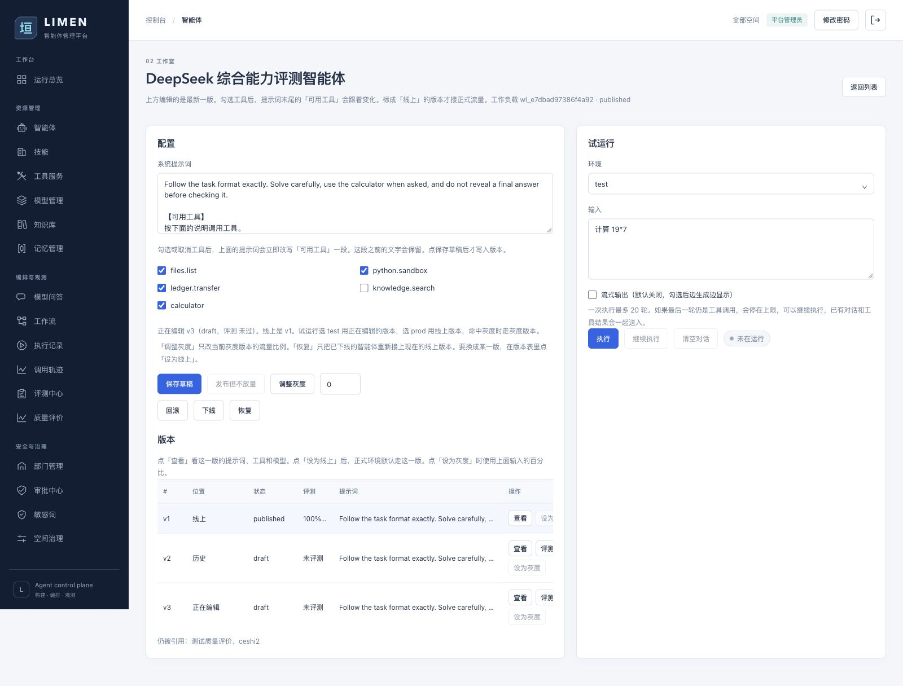
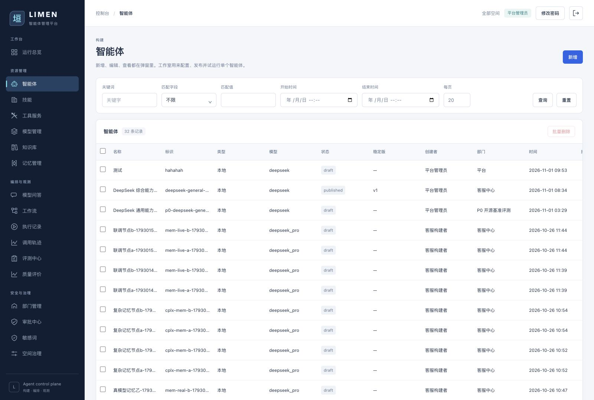

# Agent versions, schema, and queries

This guide describes the current `/agents` list and `/agents/{id}` studio. The implementation lives in `backend/app/models.py`, `backend/app/api/routers/agents.py`, `backend/app/services/runtime/support.py`, and `backend/app/paging.py`. SQL below illustrates the equivalent SQLite queries; the API constructs them with SQLAlchemy.



## Identity and immutable configuration snapshots

`agents` holds the durable identity, space, status, and live traffic pointers. `agent_versions` holds a configuration snapshot: system prompt, model, tools, child agents, MCP services, and skills. Creation inserts v1. Editing an agent or saving a draft inserts a new snapshot; previous configuration snapshots are preserved, while their release status and evaluation flag can change. Identity fields such as the name are updated on `agents`. Even an identity-only PATCH currently creates a new configuration version. Remote protocol and endpoint fields remain on `agents`, outside the version snapshot.

| Term | Meaning |
|---|---|
| Latest | Highest `agent_versions.number` for this agent; it can be a draft |
| Stable / live | Version referenced by `agents.stable_version_id`; default production traffic |
| Gray | Version referenced by `agents.gray_version_id`; receives `gray_percent` of production traffic |
| Version status | `draft`, `published`, or `rolled_back`; the pointers, rather than this field alone, determine live traffic |
| Agent status | Identity-level `draft`, `published`, or `offline` |
| Evaluation | `agent_versions.eval_passed` is the current release gate; individual reports are in `eval_runs` |

In the captured example, the DeepSeek evaluation agent has stable **v1** and latest draft **v3**. A test run uses v3; production normally uses v1. The `【v3】` prefix on a raw run means the agent node version. A workflow has a separate revision.

## Tables and constraints

| Table | Main columns | Purpose |
|---|---|---|
| `agents` | `id`, `space_id`, `name`, `key`, `workload_id`, `kind`, `status`, `stable_version_id`, `gray_version_id`, `gray_percent`, `created_by`, `created_at` | Identity, access scope, release pointers, traffic split; remote agents have protocol/endpoint fields too |
| `agent_versions` | `id`, `agent_id`, `number`, `system_prompt`, `tool_ids_json`, `child_ids_json`, `model_id`, `mcp_ids_json`, `skill_ids_json`, `status`, `eval_passed`, `created_at` | Configuration snapshot; `*_json` fields contain ID arrays |
| `eval_runs` | `agent_id`, `version_id`, `dataset_id`, `metrics_json`, `min_pass_rate`, `completion`, `passed`, `detail_json`, `created_at` | Version-specific benchmark and per-case results; workflow reports additionally use `workflow_id` and `workflow_revision` |
| `traces` | `agent_id`, `version_id`, `workflow_id`, `environment`, `input_text`, `output_text`, `status`, `created_at` | Actual run and selected agent version |

`agents` has unique constraints on `(space_id, key)` and `workload_id`; `agent_versions.agent_id` has a foreign key to `agents.id`. The stable/gray pointers and the report/trace `version_id` columns are logical references without declared foreign keys. `(agent_id, number)` is **not** unique in the current database. Two concurrent saves can both calculate `MAX(number)+1`. A future concurrency-safe migration should add a unique index and transactional retry or atomic numbering.

## Save, evaluate, release, and rollback

1. `POST /api/agents` creates the identity and draft v1.
2. `PATCH /api/agents/{id}` reads the highest version number and inserts the next snapshot. Omitted configuration fields carry forward from the previous version.
3. A benchmark can pass an explicit `agent_version_id`; the resulting `eval_runs.version_id` identifies precisely what was tested. The result updates that version's `eval_passed`. Spaces requiring evaluation, and unassigned agents, cannot release a failing version. Remote versions currently default to passing local evaluation.
4. Publishing the latest version with no stable pointer makes it stable. With an existing stable pointer, a 0% release records a gray pointer without traffic; 1–99% sends that share to gray. The studio can also promote a selected eligible version.
5. Rollback selects the nearest earlier published version as stable and clears gray traffic. Taking an agent offline changes the identity status; bringing it back online requires an eligible stable version.

The save path reads the latest row ordered by `number DESC LIMIT 1`, carries forward omitted configuration fields, and inserts a row with `number = previous.number + 1` (or 1 for the first version). `number` is the **per-agent** v-number; `id` is the globally unique version-row ID used by traffic pointers, reports, and traces. The write is equivalent to:

```sql
SELECT id, number, system_prompt, tool_ids_json, child_ids_json,
       model_id, mcp_ids_json, skill_ids_json
FROM agent_versions
WHERE agent_id = :agent_id ORDER BY number DESC LIMIT 1;

INSERT INTO agent_versions
  (agent_id, number, system_prompt, tool_ids_json, child_ids_json,
   model_id, mcp_ids_json, skill_ids_json, status, eval_passed, created_at)
VALUES
  (:agent_id, :previous_number + 1, :prompt, :tools_json, :children_json,
   :model_id, :mcp_json, :skills_json, 'draft', :eval_passed, :created_at);
```

At runtime, `test` selects the highest-numbered snapshot, including drafts. `staging` and `prod` reject offline agents and choose gray when `crc32(str(user_id).encode()) % 100 < gray_percent`; otherwise they choose stable. Without stable, they reject the run. The selected row ID is stored in `traces.version_id`, so old traces remain attributable after release pointers change.

## Query design

The platform admin sees all agents. Other users are restricted to their member spaces before applying filters. `q` searches name, key, workload ID, and status with case-insensitive `%term%`; `exact_field` is restricted to `name`, `key`, or `status`; time filters apply to `agents.created_at`. With `page`, the API counts matching rows and uses `id DESC`, `LIMIT`, and `OFFSET` (`page_size` 1–100). Without `page`, it returns the unpaginated array for existing callers.

```sql
-- Example with two authorized spaces. Expand the IN placeholders to match membership.
SELECT a.* FROM agents AS a
WHERE a.space_id IN (:space_1, :space_2)
  AND (:q = '' OR lower(a.name) LIKE :like_q
       OR lower(a."key") LIKE :like_q
       OR lower(a.workload_id) LIKE :like_q
       OR lower(a.status) LIKE :like_q)
  AND (:exact_name IS NULL OR a.name = :exact_name)
  AND (:time_from IS NULL OR a.created_at >= :time_from)
  AND (:time_to_exclusive IS NULL OR a.created_at < :time_to_exclusive)
ORDER BY a.id DESC
LIMIT :page_size OFFSET :offset;
```

The API includes only supplied filters; `:like_q` is the lowercased `%term%`. The example uses a date-only end bound and the *next day* as an exclusive upper bound, so the entire selected day is included; a specific end time instead uses `<= :time_to`. The count query uses the same predicates, without sorting or pagination. The platform admin omits the space predicate.

The list resolves stable and gray IDs and separately fetches the latest snapshot for each row. Thus its **stable version** column is not the latest version:

```sql
SELECT * FROM agent_versions
WHERE agent_id = :agent_id ORDER BY number DESC LIMIT 1;

SELECT * FROM agent_versions
WHERE id IN (:stable_version_id, :gray_version_id);
```

The studio authorizes the agent identity first, then reads all snapshots in ascending version order. Evaluation reports and traces are related by the version's row ID, not by its displayed v-number:

```sql
SELECT * FROM agents WHERE id = :agent_id;
SELECT * FROM agent_versions
WHERE agent_id = :agent_id ORDER BY number ASC;

SELECT * FROM eval_runs
WHERE version_id = :version_id AND workflow_id IS NULL
ORDER BY id DESC;

SELECT t.id, t.environment, t.status, v.number AS agent_version,
       t.input_text, t.output_text
FROM traces AS t
LEFT JOIN agent_versions AS v ON v.id = t.version_id
WHERE t.id = :trace_id;
```

`GET /api/agents/{id}` returns the ordered `versions` array. `GET /api/evals/targets/agent/{id}/runs` serves version-specific report history, and `GET /api/traces/{id}` shows the version used by a run. The server checks platform-admin or space membership access; hiding controls in the client alone is not the access boundary.


