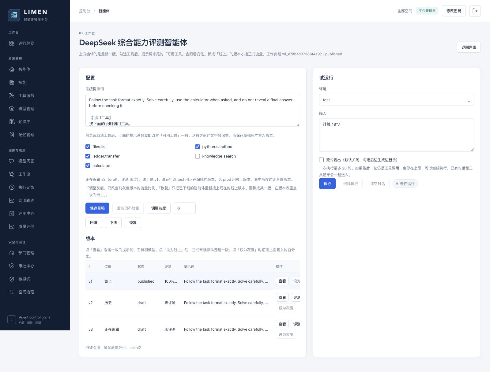
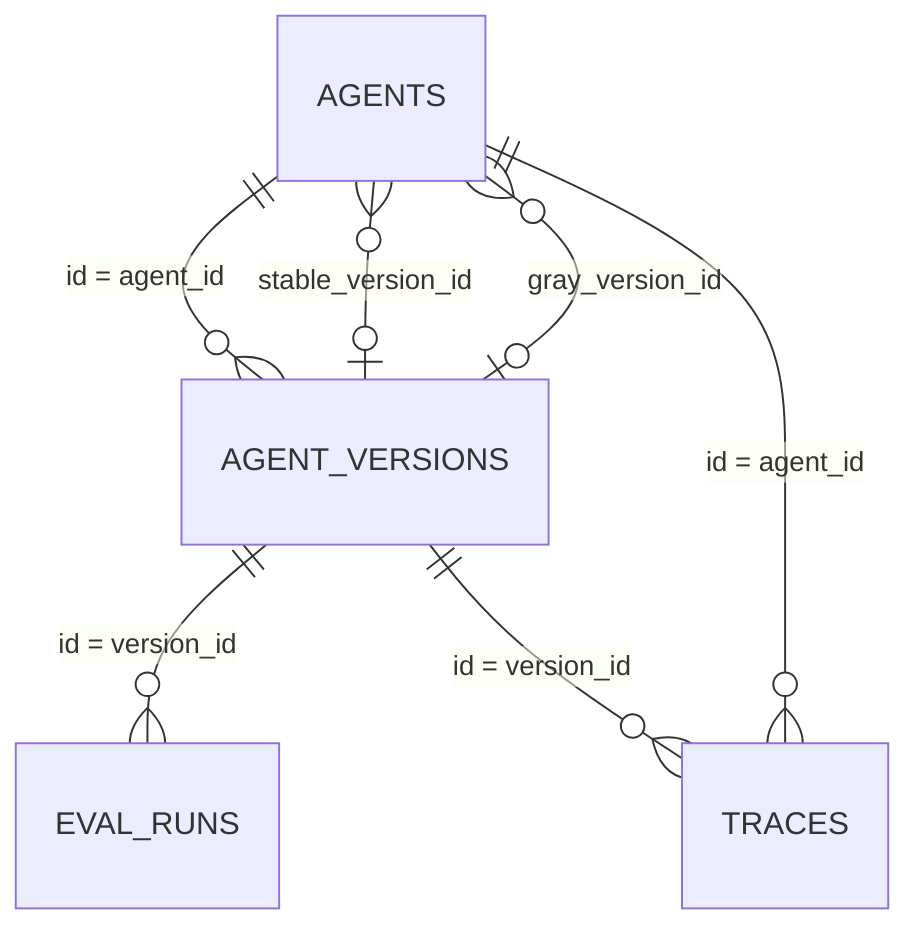
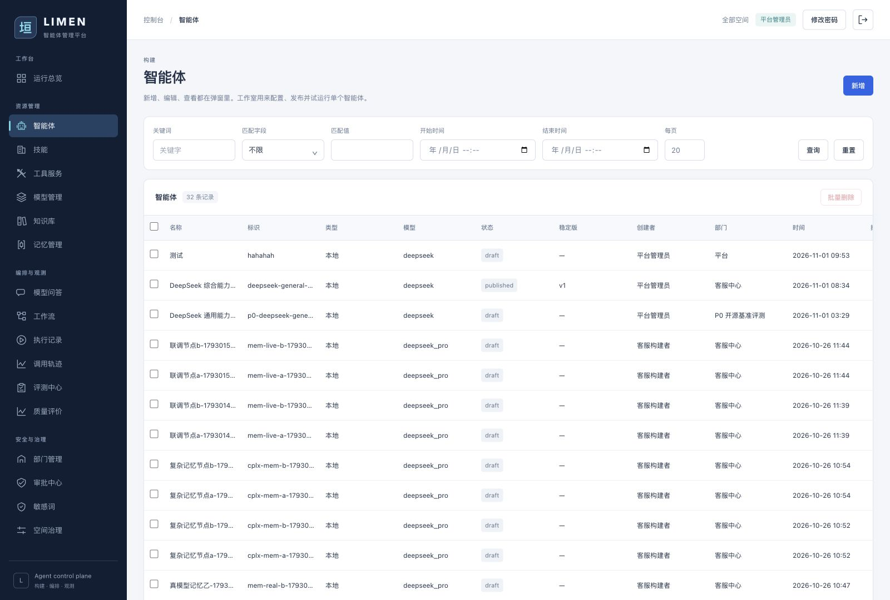

# 智能体版本与查询设计

本文按当前实现说明 `/agents` 与 `/agents/{id}` 的版本控制。实现入口为 `backend/app/models.py`、`backend/app/api/routers/agents.py`、`backend/app/api/support.py`、`backend/app/services/runtime/support.py` 和 `backend/app/paging.py`。示例 SQL 使用 SQLite 语法；接口由 SQLAlchemy 构造等价查询，并不会直接执行文中的字符串。



## 一个智能体为什么有两层数据

`agents` 是**稳定身份**：名称、部门、标识、工作负载编号、启停状态，以及当前接流量的版本指针。`agent_versions` 是**配置快照**：提示词、工具、子智能体、模型、MCP、技能及评测状态。新增智能体时同时写入身份和 v1；在管理页编辑配置，或在工作室保存草稿，都会插入一个新的版本，旧版本的配置不被覆盖。版本的发布状态及评测标记仍会随发布、评测更新。远程协议、端点等字段在 `agents` 中，当前不是版本快照的一部分。

这几个概念不能混为一谈：

| 名称 | 当前含义 |
|---|---|
| 最新版 | 同一 `agent_id` 下 `number` 最大的行，可能只是草稿 |
| 稳定版／线上版 | `agents.stable_version_id` 指向的行，正式流量默认使用 |
| 灰度版 | `agents.gray_version_id` 指向的行，仅按 `gray_percent` 分流 |
| 版本状态 | `agent_versions.status`，如 `draft`、`published`、`rolled_back`；不能只凭它判断正在接流量 |
| 智能体状态 | `agents.status`，如 `draft`、`published`、`offline`；表示身份能否对外服务 |
| 评测结果 | `agent_versions.eval_passed` 是发布门禁用的当前布尔值；每次报告保存在 `eval_runs` |

例如当前演示数据里，DeepSeek 综合能力评测智能体的稳定版是 **v1**，最新编辑版是草稿 **v3**。测试运行选 v3，正式运行默认选 v1。运行输出里的 `【v3】` 指节点智能体版本，工作流版本另由 `workflow_revision` 记录。

## 表结构与关系



| 表 | 关键列 | 用途 |
|---|---|---|
| `agents` | `id`, `space_id`, `name`, `key`, `workload_id`, `kind`, `status`, `stable_version_id`, `gray_version_id`, `gray_percent`, `created_by`, `created_at` | 身份、部门隔离、发布指针与灰度比例；远程智能体另有协议和端点字段 |
| `agent_versions` | `id`, `agent_id`, `number`, `system_prompt`, `tool_ids_json`, `child_ids_json`, `model_id`, `mcp_ids_json`, `skill_ids_json`, `status`, `eval_passed`, `created_at` | 每版的配置快照。多个 `*_json` 是编号数组，不是名称列表 |
| `eval_runs` | `agent_id`, `version_id`, `dataset_id`, `metrics_json`, `min_pass_rate`, `completion`, `passed`, `detail_json`, `created_at` | 固定目标版本的评测报告及逐题结果。工作流评测另存 `workflow_id` 和 `workflow_revision` |
| `traces` | `agent_id`, `version_id`, `workflow_id`, `environment`, `input_text`, `output_text`, `status`, `created_at` | 每次实际执行所用版本，可回溯历史输出；工作流节点调用也写智能体版本 |

当前数据库在 `(agents.space_id, agents.key)` 和 `agents.workload_id` 上有唯一约束，`agent_versions.agent_id` 有指向 `agents.id` 的外键。`stable_version_id`、`gray_version_id`、`eval_runs.version_id` 和 `traces.version_id` 当前是逻辑引用，数据库未给它们声明外键；`(agent_id, number)` 当前也未设唯一约束。因此跨进程同时保存同一智能体时，`MAX(number)+1` 可能竞争。需要支持并发编辑时，应加唯一索引，并用事务重试或原子序号分配；这属于后续数据库迁移，不应把文中的查询示例误认为已经具备该约束。

## 写入与发布流程

1. `POST /api/agents` 创建身份并写入 v1，版本状态为 `draft`。
2. `PATCH /api/agents/{id}` 或工作室「保存草稿」调用 `_save_version`：读取最新版号，加一，插入配置快照。未提交的字段沿用上一版；历史版本保持原样。修改名称等身份字段仍在 `agents` 更新。
3. `POST /api/evals/datasets/{id}/run` 指定 `agent_version_id` 评测。报告的 `version_id` 固定到被测行；评测结果更新该版本的 `eval_passed`。要求评测的空间，以及未分配空间的智能体，未通过时不能上线；远程智能体的版本按现有实现默认视为已过本机评测。
4. 「发布但不放量」发布最新版本：已有稳定版且灰度比例为 0 时，放入 `gray_version_id`，正式流量仍走稳定版；没有稳定版时直接成为稳定版。可以调整灰度比例，或在版本表把任意已满足门禁的版本设为线上／灰度。
5. 回滚选当前接流量版本之前最近的 `published` 版本作为稳定版，清空灰度指针与比例；下线只改智能体状态，恢复上线仍使用现有稳定版。

新增快照的关键读取与写入相当于以下 SQL；事务由请求的数据库会话提交，`number` 是**每个智能体内部**的 v 号，`id` 是全表唯一的版本行号，二者不能互换：

```sql
SELECT id, number, system_prompt, tool_ids_json, child_ids_json,
       model_id, mcp_ids_json, skill_ids_json
FROM agent_versions
WHERE agent_id = :agent_id
ORDER BY number DESC LIMIT 1;

INSERT INTO agent_versions
  (agent_id, number, system_prompt, tool_ids_json, child_ids_json,
   model_id, mcp_ids_json, skill_ids_json, status, eval_passed, created_at)
VALUES
  (:agent_id, :previous_number + 1, :prompt, :tools_json, :children_json,
   :model_id, :mcp_json, :skills_json, 'draft', :eval_passed, :created_at);

-- 发布时按灰度比例更新同一条 agents 行的 stable_version_id、
-- gray_version_id、gray_percent 和 status；同时把目标版本 status 设为 published。
```

## 执行时如何确定版本

| 环境 | 选择规则 |
|---|---|
| `test` | 查询该智能体 `number` 最大的版本，包括草稿。适合验证正在编辑的配置 |
| `staging`、`prod` | 先检查智能体是否 `offline`；若设置了灰度版且比例大于 0，计算 `crc32(str(user_id).encode()) % 100`，小于比例则走灰度版，否则走稳定版；没有稳定版会拒绝运行 |
| 评测中心 | 显式传入 `agent_version_id`，报告记录准确的目标版本，不依赖“最新”或线上指针 |

同一用户编号在同一灰度比例下落入的桶是稳定的。执行时把选中的 `agent_versions.id` 写入 `traces.version_id`，因此即使以后修改发布指针，旧轨迹仍能说明当时运行的是哪版。工作流当前版本是另一个概念，存于工作流与运行记录的 `revision` / `workflow_revision`。

## 查询如何设计

### 管理列表

平台管理员查询全部 `agents`；其他用户先限定为其所属空间，再套关键词、精确匹配和时间范围。接口的 `q` 对名称、标识、工作负载编号、状态做 `ILIKE '%词%'`；`exact_field` 只允许 `name`、`key`、`status`；时间筛选使用 `agents.created_at`。有 `page` 时先计总数，再按 `agents.id DESC` 分页，`page_size` 限制为 1–100；不传 `page` 时返回原始数组，供工作室等旧调用使用。

```sql
-- 非平台管理员；:space_id_list 由登录成员关系提供，不接受客户端任意扩权
SELECT a.*
FROM agents AS a
WHERE a.space_id IN (:space_id_1, :space_id_2) -- 按实际所属空间数展开占位符
  AND (:q = '' OR lower(a.name) LIKE :like_q
       OR lower(a."key") LIKE :like_q
       OR lower(a.workload_id) LIKE :like_q
       OR lower(a.status) LIKE :like_q)
  AND (:exact_name IS NULL OR a.name = :exact_name)
  AND (:time_from IS NULL OR a.created_at >= :time_from)
  AND (:time_to_exclusive IS NULL OR a.created_at < :time_to_exclusive)
ORDER BY a.id DESC
LIMIT :page_size OFFSET :offset;
```

上面是说明性 SQL：`LIKE` 参数为小写的 `%关键词%`；平台管理员省略 `space_id` 条件。实际接口只对选定的 `exact_field` 拼接一个精确条件，且只在提供参数时拼接对应筛选，不会同时传入所有空值条件。示例采用「仅填写日期」的结束时间，按次日零点做排他上界，包含当日整天；填写具体时间时实际接口改用 `<= :time_to`。分页总数使用相同的 `WHERE` 条件执行 `SELECT count(*)`，但不加 `ORDER BY`、`LIMIT`、`OFFSET`。

列表每行还读取 `stable_version_id`、`gray_version_id` 所指版本，并用如下查询取得最新版本，显示「稳定版」、最新模型等摘要；**列表的稳定版列不是最新版列**。

```sql
SELECT * FROM agent_versions
WHERE agent_id = :agent_id
ORDER BY number DESC
LIMIT 1;

SELECT * FROM agent_versions
WHERE id IN (:stable_version_id, :gray_version_id);
```

### 详情、版本表和评测报告

```sql
-- 详情和工作室版本表：先按身份及空间鉴权，再读取所有版本
SELECT * FROM agents WHERE id = :agent_id;
SELECT * FROM agent_versions
WHERE agent_id = :agent_id
ORDER BY number ASC;

-- 某一版的评测报告；前端按 target_version 分组显示最近通过率与标准
SELECT * FROM eval_runs
WHERE version_id = :version_id AND workflow_id IS NULL
ORDER BY id DESC;

-- 某次轨迹实际运行的版本
SELECT t.id, t.environment, t.status, v.number AS agent_version,
       v.status AS version_status, t.input_text, t.output_text
FROM traces AS t
LEFT JOIN agent_versions AS v ON v.id = t.version_id
WHERE t.id = :trace_id;
```

`GET /api/agents/{id}` 返回按版号升序的 `versions`，包含每版配置、状态及评测标记。`GET /api/evals/targets/agent/{id}/runs` 返回按版本关联的报告；`GET /api/traces/{id}` 可查看单次执行的实际版本。查询权限先按平台管理员或空间成员关系判断，不能仅靠客户端隐藏按钮。


